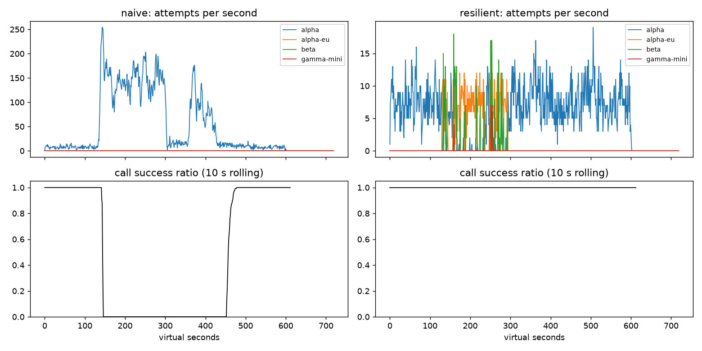

# Lab 25B — Game Day Report

**Họ tên / nhóm:** Dinh Van Binh / 2A202602830

**Commit:** 87aca9a676b24595f266a9758e8c812376055a45 (commit bài hoàn chỉnh; commit kế tiếp chỉ cập nhật dòng hash này)

**Điểm tự động:** 84/88 — toàn bộ điểm public; 4 điểm SLO hidden do giảng viên chấm.

**Kiểm tra bổ sung:** 82/82 pytest PASS; Ruff PASS; G1–G6, workflow và C1 PASS với seed 25, 26, 27 trên băng public.

## Cách tái lập và nguồn số liệu

Các bảng baseline dùng seed 25, cấu hình `configs/gameday.yaml`, số từ
`reports/gameday/*.json`, `reports/cache/*.json`, `reports/workflows.json` và
`reports/slo.json`. Các ablation dùng cùng seed 25, chỉ thay đúng tham số được
nêu, lưu toàn bộ metric trong `reports/experiments.json`:

```bash
python scripts/run_report_experiments.py
python scripts/plot_timeseries.py --scenario G2_overload_storm
python -m pytest -q
python -m ruff check src tests scripts
python scripts/grade.py --seeds 25,26,27 --out reports/scoreboard.json
```

Plot cần `pip install -e ".[plot]"`. Script thí nghiệm dùng config copy trong bộ
nhớ và subclass riêng cho ablation không lọc tool; không sửa client production,
simulator, test hay băng sự cố. Kết quả public nhiều seed không thay thế chấm
băng/dữ liệu ẩn. Các số đo khác nhau giữa ablation vì quyết định routing/retry
thay đổi chuỗi sự kiện; đây không phải phép đo production ngoài simulator.

## 1. Kết quả Game Day

| Băng | Client | Availability | p95 (s) | Amplification | Retry ratio | Cost/good turn | Recovery (s) | PASS |
|---|---|---:|---:|---:|---:|---:|---:|:---:|
| G1 | naive | 0.7194 | 7.157 | 7.738 | 6.738 | 2.163 | 4 | No |
| G1 | resilient | 1.0000 | 4.764 | 1.061 | 0.001 | 2.090 | 0 | Yes |
| G2 | naive | 0.4560 | 15.034 | 9.904 | 8.904 | 4.627 | 155 | No |
| G2 | resilient | 1.0000 | 10.822 | 1.041 | 0.007 | 2.111 | 0 | Yes |
| G3 | naive | 1.0000 | 4.768 | 1.164 | 0.164 | 2.328 | 0 | No |
| G3 | resilient | 1.0000 | 4.668 | 1.059 | 0.030 | 2.143 | 0 | Yes |
| G4 | naive | 1.0000 | 13.764 | 1.004 | 0.004 | 2.008 | 0 | No |
| G4 | resilient | 1.0000 | 5.626 | 1.014 | 0.002 | 2.072 | 0 | Yes |
| G5 | naive | 0.3699 | 5.359 | 17.030 | 16.030 | 2.124 | N/A | No |
| G5 | resilient | 0.8179 | 5.477 | 1.003 | 0.002 | 2.504 | N/A | Yes |
| G6 | naive | 0.5170 | 4.836 | 12.344 | 11.344 | 2.009 | 0 | No |
| G6 | resilient | 0.9572 | 5.882 | 1.028 | 0.012 | 2.232 | 0 | Yes |

G5 không có mốc restore nên recovery là N/A, không phải thiếu dữ liệu.
Resilient có 0 vi phạm retry-after trên mọi băng, 0 retry lỗi 400 và 0 failover
không cần thiết ở G5, 0 incompatible route ở G6. Primary share sau restore ở
G2/G4/G6 đều là 1.000. p95 chỉ tính lượt thành công: p95 thấp của naive G6
không bù được availability 0.5170.

## 2. Cấu hình client và lý do

| Tham số | Giá trị | Lý do gắn với kết quả |
|---|---:|---|
| attempt_timeout_s | 8 | G6 availability 0.9572; tăng lên 30 làm giảm xuống 0.8860 vì hết thời gian fallback. |
| max_attempts_per_provider | 2 | Một retry tối đa mỗi provider; G2 amplification 1.041 thay vì naive 9.904. |
| min_time_left_s | 1 | Không bắt đầu attempt khi chỉ còn thời gian không hữu ích; G6 baseline có 0 GiveUp deadline. |
| backoff_base_s / cap_s | 0.25 / 4 | Full jitter tránh retry đồng bộ; cả cấu hình đạt G1 amplification 1.061, 0 retry-after violation. |
| retry_budget_ratio / min_per_s / max_tokens | 0.1 / 0.5 / 20 | G3 retry ratio 0.030; khi breaker bị vô hiệu, budget giữ G3 ở 0.068 thay vì 0.158. |
| quota_cooldown_s | 300 | G5 chỉ có 2 insufficient_quota response; không retry lỗi 400, availability 0.8179. |
| breaker.window_size / min_calls | 20 / 10 | Cửa sổ hữu hạn phát hiện suy giảm; G2 recovery 0, khác ablation breaker không trip/budget off có recovery 16. |
| failure_rate_threshold | 0.5 | Chỉ lỗi sức khỏe provider vào breaker; G5 unneeded_failovers = 0. |
| slow_call_s / slow_rate_threshold | 5 / 0.6 | Phát hiện call chậm ngay cả khi thành công; G4 p95 5.626 so với naive 13.764. |
| open_duration_s | 10 | Probe lại theo khoảng nghỉ ngắn; G2 recovery 0 và primary share sau restore 1.000. |
| half_open_max_probes / half_open_successes | 2 / 2 | Giới hạn request probe đang bay; 13/13 breaker test PASS và G2 amplification 1.041. |

Các số baseline chứng minh hiệu quả của cấu hình phối hợp, không khẳng định
mỗi tham số riêng lẻ là tối ưu hay là nguyên nhân duy nhất của cải thiện.

### Quyết định `on_error`

| Loại lỗi | Ghi breaker | Retry cùng provider | Failover | Cooldown |
|---|---|---|---|---|
| 400 client error | Release permit | Không | Không; GiveUp client_error | Không |
| 429 insufficient_quota | Release permit | Không | Có | 300 s |
| 429 rate_limit_exceeded | Release permit | Không ngay; chỉ chờ nếu hết ladder và cooldown ngắn | Có | Ít nhất retry_after, dùng chung giữa các call |
| 529/503/500/timeout | Failure | Chỉ khi còn attempt, token, permit và deadline | Khi không thể retry | Breaker OPEN theo cửa sổ |

Ladder giữ thứ tự alpha → alpha-eu → beta → gamma-mini, nhưng loại gamma-mini
khỏi tool call. Khi mọi lựa chọn không dùng được, chỉ chờ cooldown rate limit
ngắn ≤ 5 s nếu còn deadline; không chờ hết quota. Permit mang generation để
kết quả cũ không đóng lại breaker mới. HALF-OPEN chỉ cấp tối đa 2 probe đang bay.

## 3. Ba thí nghiệm

### 3.1 Retry budget là lớp phòng thủ cuối

Đặt `breaker.min_calls=1000000000`, `max_attempts_per_provider=5`. Tắt budget
bằng ratio=100, max_tokens=1e9, min_per_s=1e6 đúng hướng dẫn.

| Băng | Cấu hình | Availability | Amplification | Retry ratio | Recovery (s) |
|---|---|---:|---:|---:|---:|
| G2 | Breaker chuẩn + budget | 1.0000 | 1.041 | 0.007 | 0 |
| G2 | Breaker không trip + budget | 0.9996 | 1.384 | 0.060 | 0 |
| G2 | Breaker không trip + không budget | 0.9750 | 1.584 | 0.384 | 16 |
| G3 | Breaker chuẩn + budget | 1.0000 | 1.059 | 0.030 | 0 |
| G3 | Breaker không trip + budget | 1.0000 | 1.136 | 0.068 | 0 |
| G3 | Breaker không trip + không budget | 1.0000 | 1.162 | 0.158 | 0 |

Khi breaker cấu hình sai, budget giảm retry ratio G2 từ 0.384 xuống 0.060 và
tránh phần lớn mất availability/recovery chậm. G3 vẫn đạt availability 1.0
khi tắt budget, nhưng retry ratio 0.158 vượt yêu cầu 0.10: thành công chưa đủ
để kết luận an toàn. Breaker chặn provider đang suy giảm; budget giới hạn
retry trong thời gian chưa đủ mẫu để trip hoặc khi breaker bị cấu hình sai.
Cần cả hai vì chúng bảo vệ ở hai lớp khác nhau; budget không giới hạn toàn bộ
amplification do failover cũng tạo attempt.

### 3.2 Attempt timeout 30 giây

| Băng | Timeout | Availability | p95 (s) | GiveUp reasons |
|---|---:|---:|---:|---|
| G6 | 8 | 0.9572 | 5.882 | no_provider_available: 102 |
| G6 | 30 | 0.8860 | 5.254 | deadline: 117; no_provider_available: 155 |
| G4 | 8 | 1.0000 | 5.626 | Không |
| G4 | 30 | 1.0000 | 5.608 | Không |

Ở G6, p95 giảm nhưng availability mất 7.12 điểm phần trăm: lượt bị treo/hết
hạn bị loại khỏi phân phối latency thành công (survivorship bias). Alpha-eu
treo có thể dùng hết deadline, không còn cơ hội beta. G4 gần như không đổi vì
call chậm vẫn thường kết thúc trước timeout 8 s, slow-call breaker mới là
control chính. Timeout nên dựa trên p99 bình thường, deadline còn lại và thời
gian dành cho ít nhất một fallback, không đơn thuần đặt bằng deadline user.

### 3.3 Bỏ lọc tool calling

| G6 | Availability | Incompatible routes | GiveUp incompatible_model_output |
|---|---:|---:|---:|
| Có lọc | 0.9572 | 0 | 0 |
| Không lọc | 0.8939 | 253 | 253 |

Lựa chọn model rẻ nhưng không thực hiện được tool tạo ra 253 tuyến sai và
làm availability giảm 6.33 điểm phần trăm. Với product manager: đây là giao
việc hoàn tiền cho một model chỉ nói chuyện, nên khách nhận lượt thất bại thay
vì hoàn tất hành động. Chi phí/good turn còn tăng từ 2.232 lên 2.269; rẻ mỗi
call không có nghĩa rẻ mỗi lượt thành công.

## 4. Workflow hoàn tiền

| Executor | Completion | Crashes | Duplicate refunds | Duplicate emails | Lost refunds | Overpaid (cents) | Wasted LLM/crash |
|---|---:|---:|---:|---:|---:|---:|---:|
| naive | 1.000 | 81 | 128 | 81 | 0 | 1496700 | 1.123 |
| yours | 1.000 | 66 | 0 | 0 | 0 | 0 | 0.303 |

500 workflow hoàn tất, 500 payment execution và 2500 checkpoint write. Key
ổn định theo session/step giúp payment/email deduplicate khi response mất hoặc
worker crash sau side effect. Checkpoint sau thành công giúp resume bỏ qua
các bước đã hoàn tất, thay vì tính lại LLM: idempotency riêng không tránh
recompute, checkpoint riêng không deduplicate side effect chưa kịp lưu kết
quả. Nếu checkpoint trước payment, crash có thể khiến resume bỏ qua khoản
hoàn tiền chưa từng được thực hiện. WorkerCrash phải thoát executor để runner
mô phỏng restart; không bắt nó như một ServiceTimeout bình thường.

## 5. Alerting và error budget

| Sự cố | Mong đợi | Naive | Burn-rate | Độ trễ burn-rate (phút) |
|---|---|---|---|---:|
| checkout_bug | page | page (1 phút) | page | 27 |
| provider_outage | page | page (0 phút) | page | 4 |
| deploy_blip | none | false page | Không page | N/A |
| slow_leak | ticket | Không phát hiện | ticket | 1337 |
| degraded_evening | page | page (214 phút) | page | 291 |
| night_spike | none | false page | Không page | N/A |
| small_bump | none | false page | Không page | N/A |

Naive có 7 page, 0 ticket, 3 false page; burn-rate có 3 page, 1 ticket,
0 false page. Prefix sum cho phép lấy tổng bad/total từng cửa sổ nhanh; page
14.4× cần cả 1h/5m, page 6× cần cả 6h/30m, ticket 1× cần cả 3d/6h.

30 ngày có 25,901,755 request; allowed bad = 25,901,755 × 0.005 = 129,508.775.
55,618 bad tương ứng availability 0.997853, tiêu 42.95% budget, còn 57.05%.
Không cần freeze release theo tiêu chí budget chưa hết, nhưng vẫn xử lý
slow_leak qua ticket. `small_bump` có 12% lỗi trong 20 phút: burn tức thời
24× nhưng pha loãng trên 1h chỉ khoảng 8×, dưới 14.4×; trên 6h khoảng
1.33×, dưới 6× (ước lượng traffic đều). Dữ liệu thực tế cũng không thỏa cả
hai cửa sổ, nên không đánh thức on-call chỉ vì cửa sổ 5m vượt ngưỡng.

## 6. Postmortem blameless — G2 với naive

### Tóm tắt và ảnh hưởng

Mất 75% năng lực GPU alpha tại t=120 kích hoạt retry storm trong thiết kế retry
ba tầng. Hàng đợi và retry duy trì quá tải ngay cả sau khi năng lực phục hồi
tại t=300. Resilient phá vòng phản hồi bằng retry budget, jitter, breaker và
fallback tương thích, đưa amplification từ 9.904 xuống 1.041.

Trong tape 600 s, naive chỉ phục vụ tốt 1,077/2,362 lượt: **1,285 lượt thất
bại (54.40%)**; 34,475 attempt cho 3,481 logical call, 2,737 timeout,
28,381 retry-after violation. Sự cố provider kéo dài 180 s; cửa sổ phục hồi
đầu tiên theo metric bắt đầu tại t=455, tức chậm thêm 155 s và tổng khoảng
335 s từ trigger tới đầu cửa sổ phục hồi. Không có nghĩa mọi lượt đều thất
bại trong toàn bộ 335 s.

Giả sử cả tháng chỉ có sự cố này, traffic nền 4 lượt/s liên tục trong 30 ngày
và SLO tính theo **lượt user**, tổng tháng = 10,368,000 lượt; budget 0.5% =
51,840 lượt lỗi. 1,285 lỗi tiêu **2.48% budget tháng**, không vượt toàn bộ
budget. Nếu chỉ nhìn tape 600 s, budget cho 2,362 lượt là 11.81 lỗi: tiêu
108.81 lần budget cục bộ. Đây là hai mẫu số khác nhau, không dùng tỷ lệ lỗi
tape như tỷ lệ lỗi tháng; SLI tháng phần 5 tính theo request, không trộn đơn vị.

### Hình và timeline từ CSV



Nguồn: `gameday/naive_G2_overload_storm_timeseries.csv`;
`experiments.json:g2_timeline`. Mỗi dòng dưới dùng cửa sổ lùi [t−9, t],
attempts/s trung bình 10 s và tỷ lệ **logical call** hoàn tất thành công.

| t (s) | Sự kiện | Attempts/s (10s) | Calls done (10s) | Call success ratio (10s) |
|---:|---|---:|---:|---:|
| 120 | Bắt đầu mất năng lực; cửa sổ vẫn chủ yếu trước sự cố | 9.1 | 90 | 1.000 |
| 150 | Retry storm đã khuếch đại tải | 208.9 | 50 | 0.000 |
| 180 | Queue/timeout duy trì vòng lặp | 114.8 | 32 | 0.000 |
| 240 | Tiếp tục gửi vào primary nghẹt | 138.2 | 56 | 0.000 |
| 300 | Năng lực provider phục hồi, client chưa hồi phục | 142.9 | 43 | 0.000 |
| 330 | Tải giảm nhưng call cũ vẫn thất bại | 14.2 | 27 | 0.000 |
| 455 | Đầu cửa sổ phục hồi theo grader | 13.5 | 40 | 0.300 |

Metric recovery dùng **cửa sổ tiến 30 s**, khác đường biểu đồ cửa sổ lùi 10 s:
[455,485) có 352/368 call thành công = 95.65%, nên recovery = 455−300 =
155 s. Tỷ lệ lùi 0.300 tại t=455 không mâu thuẫn với metric recovery này.

### Trigger, root cause và điều giúp/làm tệ hơn

Trigger là mất GPU, không phải hành động sai của một cá nhân. Root cause là
thiết kế ba lớp retry app × gateway × SDK (tối đa 36 attempt/call), delay cố
định, thiếu jitter/budget/breaker và không spillover. Các lớp retry được thiết
kế riêng nhưng không có một ngân sách attempt chung hay kiểm tra tích hợp
cho suy giảm năng lực.

Sau t=300, request đã bị client bỏ vẫn chạy trên server; retry mới tiếp tục
đẩy arrival rate vượt khả năng phục vụ. Vòng lặp timeout → retry → queue tăng
→ timeout duy trì metastable failure dù trigger đã kết thúc. Tôn trọng
retry-after và giới hạn retry giúp giảm lượng request vô ích; fallback và
slow/failure breaker giảm áp lực primary. Fixed delay, timeout rồi retry trên
cùng provider, và ba lớp retry chồng nhau làm xấu hơn. Resilient giữ 100%
availability G2, recovery 0 và primary share sau restore 1.000, dù p95 vẫn
10.822 s cần cải thiện.

### Action items

| # | Hành động | Loại | Owner | Kiểm chứng |
|---:|---|---|---|---|
| 1 | Một tầng retry, full jitter và shared retry budget | prevent | Platform | G2 amplification ≤ 1.2 và G3 retry ratio ≤ 0.10 trong CI nhiều seed |
| 2 | Dashboard attempts/logical call, timeout, queue và page theo SLO burn | detect | SRE | Inject G2; xác nhận dashboard thấy storm và page khi đủ hai cửa sổ; 0 false page public blip |
| 3 | Capability-aware fallback, slow-call breaker và giới hạn probe | mitigate | Agent team | G6 incompatible_routes = 0; G4 p95 ≤ 10 s; G2 recovery ≤ 30 s, primary share ≥ 0.80 |
| 4 | Review cấu hình và ablation breaker không trip | prevent | Reliability reviewer | Budget-on G2 amplification ≤ 1.6; lưu metric trước/sau để phát hiện regression |

## 7. Điểm yếu còn lại

G2 p95 thành công 10.822 s, p99 15.777 s dù availability 1.0. G6 còn 102
lượt GiveUp khi không có provider khả dụng; fallback cũng có giới hạn rate
limit. Cải thiện tiếp theo: timeout theo p99 bình thường của mỗi deployment
và deadline còn lại, admission control theo năng lực fallback, rồi kiểm tra
băng ẩn/nhiều seed để tránh tuning quá khớp băng public. Không giảm timeout
mù quáng vì request bị bỏ vẫn tiêu thụ server capacity.

## 8. Semantic cache và stale-if-error

### Baseline và cấu hình cuối

| Client | Availability | FAQ availability | Hit ratio | Stale served | Wrong | Outdated | Cost/good turn | PASS |
|---|---:|---:|---:|---:|---:|---:|---:|:---:|
| resilient (không cache) | 0.8380 | 0.8430 | 0.000 | 0 | 0 | 0 | 1.386 | No |
| cached | 0.9113 | 0.9634 | 0.580 | 153 | 0 | 4 | 0.965 | Yes |

| Tham số | Giá trị | Lý do dựa trên số liệu |
|---|---:|---|
| similarity_threshold | 0.97 | 0 wrong_answers; 0.80 tạo 175 other_question dù hit cao hơn. |
| ttl_s | 60 | Hit 0.580 và outdated 4; TTL 30 hit 0.499 dưới yêu cầu, TTL 300 outdated 95 vượt giới hạn 15. |
| max_stale_s | 300 | Bao phủ outage 120 s; FAQ availability 0.9634 so với 0.8750 khi tắt stale. |
| max_entries | 500 | Giới hạn bộ nhớ; cấu hình này đạt hit 0.580. Chưa ablate kích thước để tuyên bố 500 tối ưu. |

Lookup cùng prompt_version, loại câu hỏi personal, cosine ≥ threshold; TTL
hết chỉ dùng stale khi provider GiveUp và entry còn trong cửa sổ cho phép.
Webhook invalidate theo source. Prompt deploy không được dùng câu trả lời
scope cũ. Ở cấu hình cuối, wrong_answers_by_reason rỗng; không nhầm câu hỏi,
không cross-user, không dùng old_prompt hay bỏ qua invalidation.

### 8.1 Thí nghiệm ngưỡng

Giá trị chọn cuối trùng 0.97, nên cột “giá trị của bạn” và đối chứng 0.97 là
cùng một run, không giả tạo thêm phép đo khác.

| Similarity | Hit ratio | Wrong answers | Wrong by reason | Cost/good turn |
|---:|---:|---:|---|---:|
| 0.80 | 0.659 | 175 | other_question: 175 | 0.979 |
| 0.97 (chọn cuối / đối chứng) | 0.580 | 0 | {} | 0.965 |

Ngưỡng 0.80 đổi độ chính xác lấy hit; FAQ availability giảm từ 0.9634 xuống
0.8605 vì trả lời sai cũng bị tính thất bại. Catalog có các cặp gần nhưng
khác nghĩa: “Chính sách hoàn tiền thế nào?” vs “Hoàn tiền mất mấy ngày?”,
đổi size vs đổi màu, phí ship nội thành vs đi tỉnh; centroid near-miss khoảng
0.86 nên 0.80 có thể trộn intent. Metric tổng chỉ xác nhận 175 lỗi
other_question, không có trace từng câu để kết luận chính xác bao nhiêu lỗi
thuộc mỗi cặp. Cost/good turn còn tăng dù gọi provider ít hơn.

### 8.2 Thí nghiệm TTL

| TTL (s) | Hit ratio | Wrong | Outdated | FAQ availability | Cost/good turn |
|---:|---:|---:|---:|---:|---:|
| 30 | 0.499 | 0 | 2 | 0.9616 | 1.020 |
| 60 | 0.580 | 0 | 4 | 0.9634 | 0.965 |
| 300 | 0.701 | 0 | 95 | 0.9628 | 0.882 |

Webhook t=150 giúp invalidate tài liệu được báo thay đổi, nhưng thay đổi phí
ship t=480 là silent: không có event cho client để invalidate. Trong các
control đang mô phỏng, TTL là cách giới hạn thời gian entry còn được coi là
fresh; TTL 300 giảm cost nhưng trả 95 outdated, còn 60 cân bằng hit và độ mới.
TTL không phải bảo đảm tuyệt đối về freshness nếu cho phép stale-if-error:
entry cũ vẫn có thể được phục vụ thêm khi provider lỗi, nên max_stale cũng
phải giới hạn, hoặc dùng revalidation/version check trong production.

### 8.3 Thí nghiệm tắt stale-if-error

| max_stale_s | FAQ availability | Hit ratio | Availability | Cost/good turn |
|---:|---:|---:|---:|---:|
| 300 | 0.9634 | 0.580 | 0.9113 | 0.965 |
| 0 | 0.8750 | 0.494 | 0.8572 | 1.025 |

Tắt stale mất 8.84 điểm phần trăm FAQ availability và không đạt mục tiêu
0.93. Cache final phục vụ 153 stale response để giữ FAQ qua outage; stale
không được dùng sau webhook invalidation hoặc xuyên prompt scope. Không
cache câu hỏi cá nhân dù theo từng user: trạng thái đơn, tiền hoàn và điểm
có thể thay đổi nhanh; embedding gần không bảo đảm cùng đơn/hành động, và
câu trả lời cũ có thể gây quyết định sai. Trong outage vẫn có lượt personal
và tool không thể cứu bằng cache, nên availability tổng thấp hơn FAQ.

Dashboard user availability xanh nhờ cache không có nghĩa provider khỏe.
On-call cần theo provider error/timeout rate và burn-rate trên provider call,
breaker state, stale_served theo thời gian, cache miss failure rate và tuổi
entry, cùng freshness/wrong-answer metric. Báo động chất lượng stale/freshness
cần tách với SLO thành công user; không coi một cached response là một lần
provider thành công.
